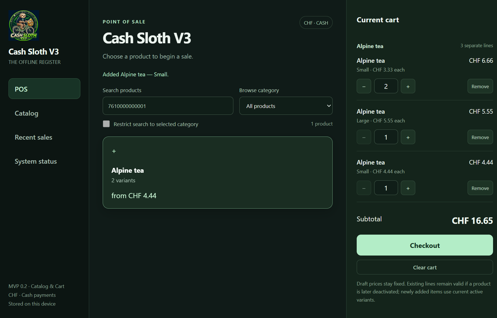
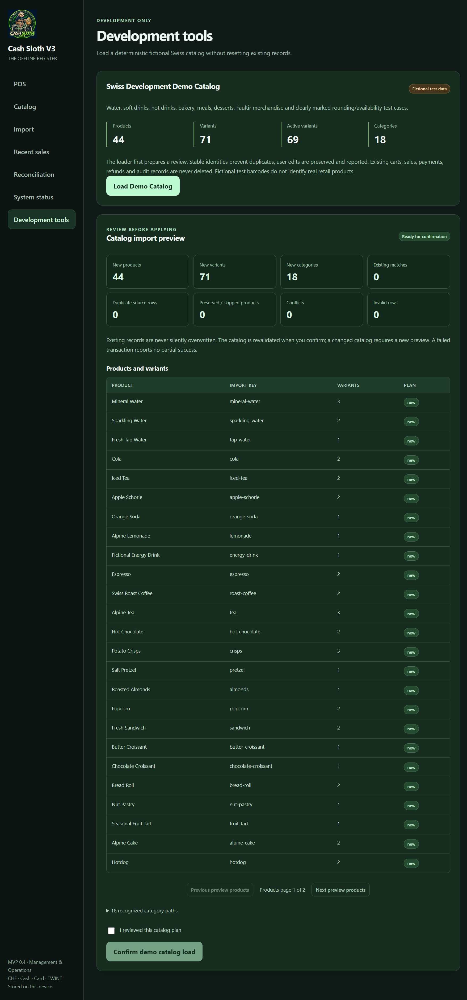
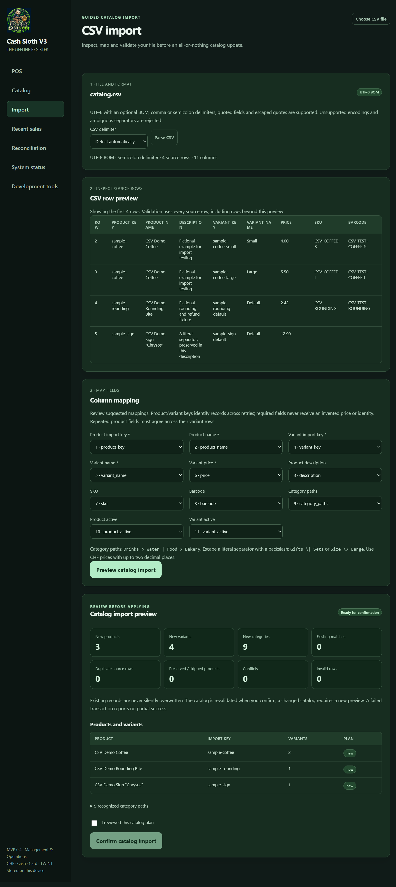
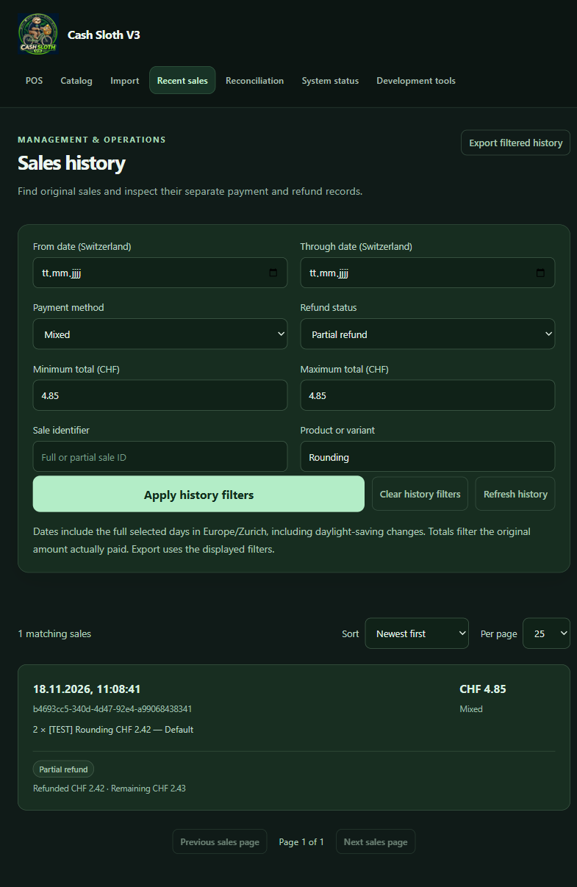
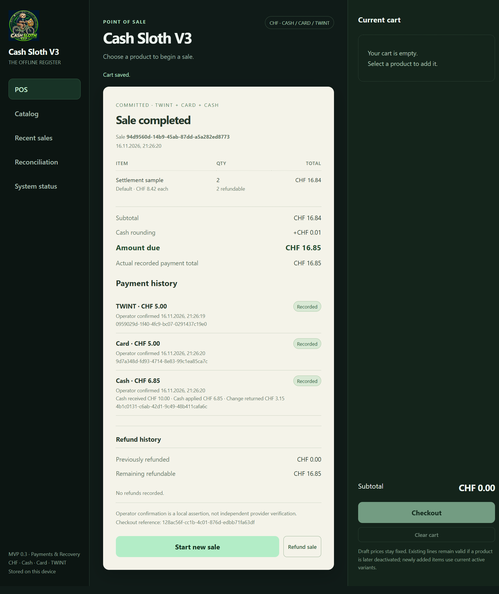
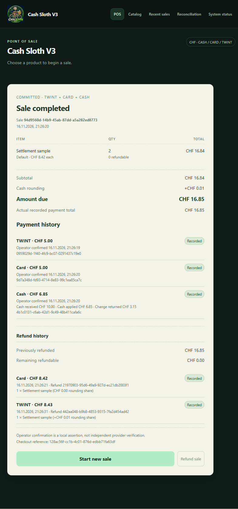
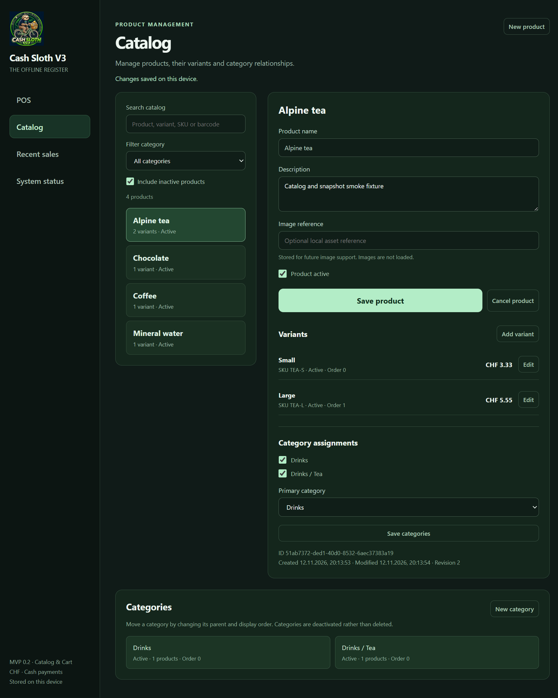
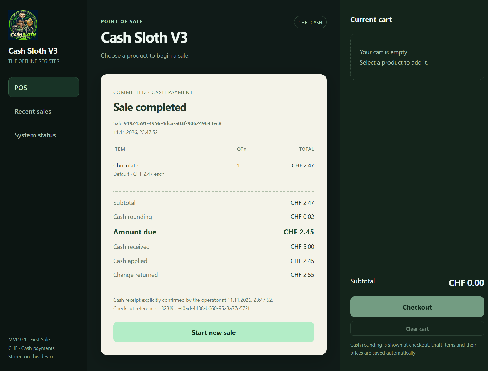

# Cash Sloth V3

**An offline-first point of sale for Switzerland.**

Built by **Faultir Softworks** · CHF · Windows desktop · Future Raspberry Pi host

*Internal operation: **[OP Faultir Chrysos](docs/project-identity.md)** · χρυσός — gold.*

Cash Sloth V3 rebuilds the register from the ground up with clear module
boundaries, reliable local storage and shared business logic. Small businesses,
clubs and events are the intended users. Correctness and data integrity come first.

> **Current milestone: MVP 0.4 — Management & Operations**
>
> Explicit Swiss demo data, reviewed CSV catalog imports, searchable sales history
> and linked financial exports build on the existing payment/refund foundation.
> This remains a development MVP, not a production release.

[Get started](docs/setup.md) · [Architecture](docs/architecture.md) ·
[Management guide](docs/mvp-0.4.md) · [Sample CSV](examples/catalog-import.csv) ·
[Payments & recovery](docs/mvp-0.3.md) · [Testing](docs/testing.md) ·
[Branding](docs/branding.md) · [MVP report](docs/mvp-0.4-report.md)

## A first look



*The Windows catalog/cart view, captured during MVP 0.2. The expanded payment and
refund workflow is shown below. Runtime diagnostics remain under System status.*

<details>
<summary>View guided import, Swiss demo data and filtered history</summary>







*Actual Electron captures from disposable Development data. Imports require a
reviewed plan; exports preserve linked original sales, allocations and refunds.*

</details>

<details>
<summary>View a mixed sale and its refund history</summary>





*Captured from the real Electron workflow: CHF 16.84 subtotal, CHF 16.85 paid,
then historical refunds of CHF 8.42 and CHF 8.43. No provider API was contacted.*

</details>

<details>
<summary>View the catalog editor</summary>



</details>

<details>
<summary>View the committed cash-sale receipt</summary>



</details>

## What works today

| Area | Current implementation |
| --- | --- |
| Catalog editor | Create/edit/deactivate products and priced variants; revision-aware saves |
| Swiss demo | Explicit Development-only load: 44 products, 71 variants and 18 categories; preserves user edits |
| CSV import | Native file selection, UTF-8 parsing, column mapping, review, conflicts and atomic idempotent apply |
| Categories | Deep hierarchies, multiple assignments, optional primary category and deduplicated counts |
| Product browser | Global name/variant/SKU/barcode search, explicit category restriction, variant chooser |
| Cart | Saved drafts, grouped snapshot lines, quantity/remove actions and confirmed clearing |
| Checkout | Fast cash and guided Card/TWINT, partial allocations and mixed final-cash settlement |
| Money | Integer Rappen, exact digital payments, residual cash rounding, separate tender/change |
| Sales | Idempotent atomic completion, stable attempt keys and immutable receipts |
| Refunds | Selected historical units, partial/full refunds, cumulative limits and exact rounding allocation |
| Recovery | Durable transfer assertions, explicit uncertain states and reasoned local reconciliation |
| History | Swiss date, method, amount, refund and historical-text filters; bounded pages and retained detail navigation |
| CSV export | Five linked financial tables, exact Rappen and safe host-mediated new export directories |
| Desktop | Responsive React/Vite POS inside Electron |
| Host communication | Narrow system/POS/catalog/payment APIs with runtime validation and sender checks |
| Isolation | Sandboxed renderer, context isolation, no Node integration |
| Persistence | Built-in `node:sqlite`, native Drizzle adapter, WAL and foreign keys |
| Standalone host | Electron-independent Node service on `127.0.0.1` |
| Environments | Separate Development, Beta and Stable data paths |
| Quality gates | Strict TypeScript, ESLint, architecture checks, Vitest and real-process smoke tests |

Real Card/TWINT integrations, analytics and
customer-display pairing are **not implemented**. `apps/customer-display` reserves
a future boundary; the UI offers English and German under Settings, with Light, Dark and System appearance modes. No receipt printer integration is included.

Card/TWINT confirmations are operator assertions, not provider verification.
Cash is the last method in a mixed checkout. Partial cash refunds must be payable
in CHF 0.05 denominations; otherwise choose a digital method or more units.
Reconciliation uses local trust and deliberate confirmation; there is no user
authentication or role management. See the [financial rules](docs/mvp-0.3.md).

## Run it locally

Use **Node.js 24.22.1** and **pnpm 11.25.0**. Run commands from the repository root:

```sh
pnpm install --frozen-lockfile
pnpm dev
```

`pnpm dev` builds the UI and hosts, then opens the desktop application in the
Development channel. It is a build-and-launch command, not a hot-reload server.
Initial setup and Electron's first binary download need internet access; the
running desktop uses local assets and data. In Development, choose Chocolate,
select Checkout, enter `5.00`, explicitly confirm cash receipt and complete the
sale. CHF 2.47 rounds to CHF 2.45 due, returning CHF 2.55 change. See the
[payment/refund walkthrough and recovery instructions](docs/mvp-0.3.md#manual-workflow).

To populate a realistic test register, open **Development tools → Load Demo
Catalog**, review and confirm. Repeated loading does not duplicate matching data
or overwrite your edits. **Import** accepts the sample CSV above; **Sales history**
opens filtered history and export. See the [management walkthrough](docs/mvp-0.4.md).

The hamburger opens an animated, opaque application menu over the POS categories.
Closing it reveals the same category selection, expanded branches and scroll position.
Choose a category to browse its descendants, or expand its children separately;
your category and search state survive tab changes. See [navigation](docs/navigation.md).

To run the standalone Node host instead:

```sh
pnpm build
pnpm start:pi
```

Its diagnostic endpoint is `http://127.0.0.1:3210/api/system/info`. The current
React shell uses the Electron bridge; a Chromium-to-Pi-host UI adapter is future work.
See [setup](docs/setup.md) for data paths and configuration.

## Architecture at a glance

```text
apps/
  desktop/                 Electron main, preload and secure IPC
  pos-ui/                  React/Vite presentation
  customer-display/        Reserved for a later milestone
  pi-host/                 Independent, loopback-only Node host
packages/
  domain/                  Money, cart, payment, sale and refund invariants
  application/             Use cases and host-independent ports
  contracts/               Runtime-validated communication contracts
  infrastructure-sqlite/   Additive migrations, financial journal and repositories
  platform/                Channel selection and host data paths
  ui/                      Shared React components
  i18n/                    Foundation copy; full localization comes later
```

Domain stays independent of UI, database and host APIs. Application depends on
interfaces; infrastructure implements adapters; hosts compose them. React never
opens SQLite. Automated [dependency checks](docs/architecture.md) protect these boundaries.

## Verify the foundation

```sh
pnpm check
```

This runs type checking, lint and architecture checks, unit/integration tests,
builds, and actual Electron/Node smoke tests, including a sale across application
restarts. Windows x64 has been tested locally;
Linux CI and Raspberry Pi ARM64 results are still open. The PR workflow is prepared
but has not been run on GitHub. See the [compatibility matrix](docs/platform-compatibility.md).

**SQLite decision:** `node:sqlite` with `drizzle-orm@1.0.0-rc.5` passed the current
Node and Electron probes. Drizzle is pinned to a release candidate: the tradeoff
and production gate are recorded in [ADR 0001](docs/adr/0001-sqlite-driver.md).

## Development direction

| Milestone | Scope | State |
| --- | --- | --- |
| Phase 5.0a | Project governance | Completed |
| Phase 5.0b | Technical foundation | Implemented; local Windows checks passed |
| MVP 0.1 | First persisted cash sale | Implemented; see the completion report |
| MVP 0.2 | Managed catalog, variants, categories, search and cart refinement | Implemented; see the completion report |
| MVP 0.3 | Manual/mixed payments, historical refunds and explicit recovery | Implemented; see the completion report |
| MVP 0.4 | Safe demo/CSV population, searchable history and linked financial exports | Implemented; see the completion report |
| Later MVPs | Further approved POS modules | Planned |

Cash checkout uses integer Rappen and preserves historical snapshots. A sale is
shown as successful only after confirmed commit. Uncertain results retain the
original attempt reference for reconciliation; never repeat an external transfer
for a database retry. Stale confirmations require deliberate investigation and
an immutable resolution record before their locks are released. See the
[payment and refund decisions](docs/adr/0004-payment-ledger-and-refund-allocation.md).

Read [AGENTS.md](AGENTS.md) before contributing. Detailed specifications and
architecture decisions live in [docs/](docs/).

## License

Copyright © 2026 Armon Flurin Elvedi. The original Cash Sloth V3 software and
project documentation are licensed under the [Faultir Softworks Source-Available
License, version 1.0 (FSSL-1.0)](LICENSE).

The license permits source inspection and private non-commercial use and
modification. Commercial use requires prior written authorization. Sections 5–7
cover redistribution, branding and independently licensed third-party materials.
See the [third-party dependency inventory](docs/licensing/third-party-inventory.json).
