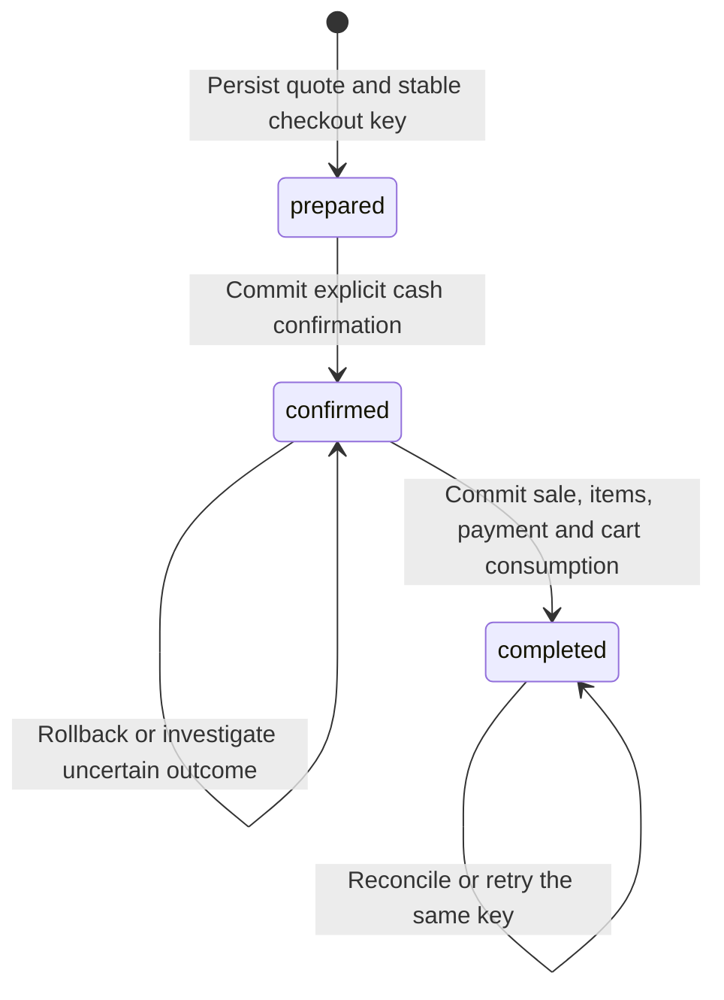

# ADR 0002: Persistent cash checkout and commit reconciliation

Date: 2026-11-11

Status: Accepted for MVP 0.1 development.

## Decision

Keep the existing `node:sqlite` driver, Drizzle connection and platform boundaries.
Domain owns money, cart snapshots and financial invariants. Application owns the
single `CompleteSaleUseCase` and a synchronous `PosStore` port. SQLite implements
that port; Electron composes it and exposes only validated POS operations.

The adapter uses bound `DatabaseSync` statements and explicit `BEGIN IMMEDIATE` /
`COMMIT` / `ROLLBACK` on the existing connection. This makes the precise commit
boundary and failure classification directly testable. It does not introduce a
different driver or ORM. Drizzle remains pinned and covered by existing runtime
probes; no Drizzle Kit dependency or generated migration workflow is added.

The first schema is immutable versioned SQL embedded in a TypeScript migration,
with version, name and SHA-256 recorded in `schema_migrations`. Embedding avoids
different SQL-resource paths between the bundled Electron and Node runtimes.
Future schema changes require a new migration. Unknown, missing or altered
applied versions fail closed without recreating the database.

## Checkout lifecycle

Confirmation is a separate durable transaction **before** the final sale
transaction. It records received cash and the host-generated operator-action
timestamp. It deliberately survives a later rollback or stale-cart conflict:
software cannot undo the physical transfer.

The final transaction inserts a sale aggregate, seals its item/payment snapshots,
consumes the exact cart revision and marks the attempt completed. Success is
returned only after COMMIT returns. A unique checkout key and unique sale cart ID
prevent duplicate sales. The key is permanently bound to its quote and, after
confirmation, its exact received amount and confirmation timestamp.

Known rollback and uncertain commit are distinct persistence outcomes. Either
may be presented as an error; neither becomes a successful receipt. Reconciliation
reads the original key and returns the stored attempt and any committed sale.
Manual retry uses the same key and amount, never a fresh physical payment.

## Concurrency and evidence

Cart mutations carry an expected revision. A confirmed unresolved checkout blocks
new mutations/preparation. A competing confirmation is still durably recorded,
then blocked from producing a conflicting sale. Multiple confirmations are kept
as evidence rather than discarded by a uniqueness constraint; `sales.cart_id`
still permits only one sale for the cart.

A stale quote after physical confirmation can therefore leave the register
locked for investigation. MVP 0.1 has no administrative resolution/void UI for
that exceptional case. It must not silently erase the confirmation, rewrite the
cart to match it or pretend cash was returned. Use one operator session per
register during this development MVP.

## Renderer recovery

The renderer saves only a versioned recovery pointer (checkout key and nullable
received amount) in channel-isolated local storage. SQLite remains authoritative.
The pointer is saved before submitting confirmation and retained across failed
or lost replies. Startup only reconciles; it never automatically submits payment.
An invalid/unreadable pointer blocks checkout. Receipt acknowledgement may clear
only the pointer belonging to that exact receipt, not an unrelated unresolved key.

Sale snapshots are sealed inside the final transaction. SQLite triggers reject
later sale/item/payment inserts, updates and deletes. The unsealed assembly state
is internal to persistence and is never exposed as a completed sale. Runtime
schemas and Domain invariants validate data read from disk before use.

## Evidence and limits

Tests exercise real on-disk rollback before commit, lost acknowledgement after
confirmation and sale commits, database reopening, competing checkout keys,
snapshot price changes and raw SQL mutation rejection. Electron tests perform
actual draft/sale restarts through the user interface. These are development
checks; production release, hardware power-loss behavior, backups and ARM64
remain separate gates. See [MVP 0.1](../mvp-0.1.md).
