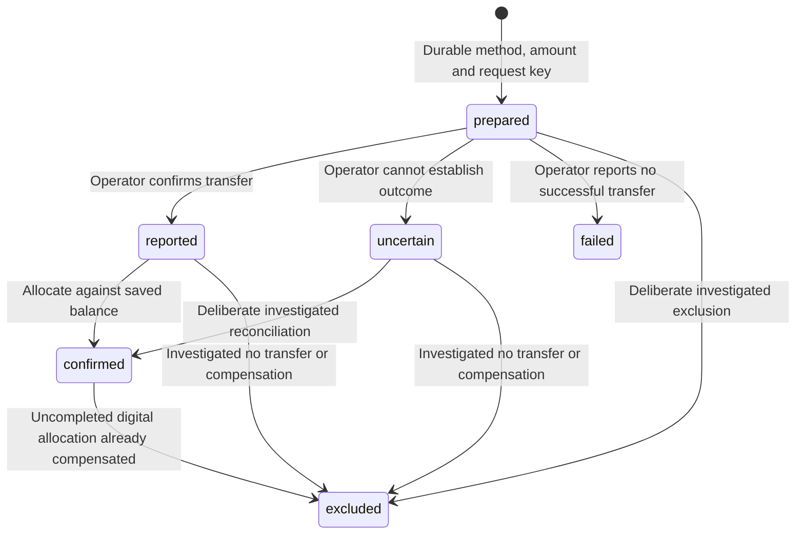

# MVP 0.3 — Payments, Refunds & Recovery

This development milestone records manual Cash, Card and TWINT operations. It
does not communicate with a terminal, bank or TWINT provider. An operator's
confirmation is an auditable assertion, not proof of provider settlement.

## Financial model

All amounts are nonnegative safe integer Rappen unless explicitly identified as
a signed rounding adjustment. Domain calculations use checked arithmetic and
BigInt for multiplication and proportional allocation. TypeScript types are
supplemented by strict runtime contracts and validation of persisted snapshots.

| Record | Purpose |
| --- | --- |
| Checkout session | Stable identifier and immutable cart/revision snapshot |
| Payment attempt | Idempotency key, intended amount, method and durable status |
| Payment allocation | Confirmed applied amount, confirmation time, cash tender/change |
| Financial sale | Immutable item and payment snapshots, subtotal, adjustment, payable and actual paid |
| Refund attempt | Stable payout reference and reserved original units |
| Refund | Separate immutable payout, historical quantities and rounding shares |
| Financial event | Append-only status evidence |
| Reconciliation action | Append-only investigated decision, reason and idempotency key |

The existing cash `Sale` and checkout records remain readable through the old
POS contracts. The expanded payments API projects these historical sales into
one common sale-details/history model. New UI cash and guided payments use
`completeCheckout`; the legacy operation remains a compatibility boundary.
There is no new financial implementation inside React.

## Checkout and rounding

1. Start or resume a checkout for the exact saved cart revision.
2. Prepare a payment with a stable request key before reporting a transfer.
3. Review the method and amount. Execute/check the physical or external operation
   outside the application, then explicitly confirm its outcome.
4. A confirmed allocation reduces the outstanding balance. Repeat for partial
   Card/TWINT payments, or choose Cash for the final remaining portion.
5. Complete the fully settled sale. A receipt is shown only after confirmed COMMIT.

Cash must be the **last allocation** when methods are mixed. Digital allocations
are exact and cannot exceed the outstanding balance. After final cash, no
additional allocation is accepted. Cash tender and change use CHF 0.05
denominations. The applied amount excludes change.

For subtotal `S` and confirmed digital total `D`, cash due is
`roundCashRappen(S - D)`. The persisted adjustment is
`cashDue - (S - D)`. Without a cash allocation, payable remains exactly `S`.

| Subtotal | Confirmed digital | Final cash applied | Adjustment | Actual paid |
| ---: | ---: | ---: | ---: | ---: |
| 842 | 842 | None | 0 | 842 |
| 842 | 0 | 840 | −2 | 840 |
| 842 | 500 | 340 | −2 | 840 |
| 1684 | 1000 | 685 | +1 | 1685 |

The authoritative invariant is **sum of applied allocations = final payable =
actual paid**. Cash tendered is not the actual recorded payment total. A final
zero-Rappen cash remainder is permitted when rounding consumes a tiny remainder;
zero-value sale snapshots retain their explicit settlement evidence.

An open checkout locks ordinary cart mutation, including the legacy POS API.
Unconfirmed, failed and excluded attempts never contribute to the paid balance.
Prepared attempts must be resolved before changing their method or amount.

## Durable states and transaction boundaries

Preparation is one transaction. Payment confirmation first commits `reported`
evidence and its event, then allocates it in a second transaction. The final sale,
cart consumption and completed session commit together in a further transaction.
Refund confirmation similarly records the reported payout before committing the
refund aggregate. A later rollback does not erase an earlier reported transfer.

Known rollback and uncertain commit are distinct adapter outcomes. If a reply is
lost after COMMIT, the caller reads the original attempt/session; it does not
create a replacement transfer. Same-key identical preparation, confirmation,
completion, refund and reconciliation requests are safe to repeat as database
operations. This does not authorize repeating the external financial event.

## Refund algorithm and limits

Select original sale lines and quantities explicitly. Current product names or
prices do not determine the refund. A pending refund reserves its sale against
overlapping refund preparations until the outcome is resolved. Completed refunds
consume the selected quantities; cumulative money cannot exceed actual paid.

For historical subtotal `S > 0` and original paid total `P`, allocate the paid
amount over the original sale-item order. At exact-value prefix `x`, the assigned
paid prefix is `floor(P * x / S)`, calculated with BigInt. Refunding the next `q`
units of a line receives the difference between the end and start prefixes.
Each refund persists the starting unit offset, quantity, historical unit price,
base value, rounding allocation and final amount. Zero-value sales allocate zero.

Example: two units at 842 Rappen, cash sale paid 1685. The first unit is assigned
842 and the second 843. Refunding them separately returns exactly 1685, regardless
of intervening refunds of other lines. The original sale is never changed.

A refund may use a different method from the sale. **Cash refunds require the
selected allocated total to be divisible by five.** Otherwise use Card/TWINT or
select additional units. Never round each partial refund again. Fully returning
all units across any valid sequence yields exactly the original actual payment.

## Recovery and reconciliation

The renderer keeps a strict, versioned reference in channel-isolated local
storage. SQLite remains authoritative. The reference is saved before submitting
confirmation and retained on a failed or lost reply. Startup inspects stored
state only; no payment or refund is automatically repeated. Database discovery
also finds an open checkout if its UI reference is absent.

Use the recovery screen to read the stored result. If the transfer outcome is
uncertain, investigate externally and use Reconciliation. The available decisions
mean:

- **Confirm recorded:** the operator investigated and asserts the transfer/payout
  happened. Allocate/finalize the original attempt, subject to consistency checks.
- **Exclude, no transfer:** the operator investigated and asserts no transfer happened.
- **Exclude, compensated:** the operator asserts a compensating physical/external
  transfer has already been performed. The application does not perform it.

Every consequential action needs a reason and deliberate confirmation. Original
evidence remains; resolved actions are available in reconciliation history.
Confirmed digital allocations in an uncompleted checkout can be excluded only
after an explicit assertion of completed external compensation, while no active
cash attempt exists. Their original confirmation amounts/timestamps/events remain.
After all allocations are resolved, cancel the checkout to release its saved cart.
An already confirmed cash settlement should be completed and refunded through
the sale workflow instead. Never alter allocations belonging to a completed sale.

Conflicting legacy cash confirmations may be explicitly excluded after an
investigated no-transfer/compensation assertion. Consistent legacy completion
uses its original cash key; reconciliation never manufactures a replacement sale.
An uncertain refund's investigation records its new confirmation time separately
from the original unknown-outcome report, rather than backdating successful confirmation.

There is **no authentication or role system**. Reconciliation is privileged by
the trusted local Electron window/frame boundary only. Its UI confirmation is
an accident-prevention step, not administrator authentication. The Node host has
no payment, refund or administrative network API.

## Migration and isolation

Migration `0003-payments-refunds` adds payment sessions/attempts, financial sales,
refund attempts/refunds, financial events and reconciliation actions. Indexed
columns accompany runtime-validated JSON aggregate snapshots. Immutable-record
and evidence guards supplement application invariants and transaction checks.
Migrations `0001-first-sale` and `0002-catalog-management` remain unchanged;
historical cash rows are projected rather than rewritten. Migration failure
rolls back instead of deleting or resetting the database.

Development, Beta and Stable continue to use distinct directories, configurations
and databases. Automated tests use disposable Development roots and populated
historical fixtures; they never upgrade or transact against a real user's store.

## Manual workflow

Use Node 24.22.1 and pnpm 11.25.0, run `pnpm dev`, and use Development test data.

1. Add Chocolate, choose Checkout, enter `5.00`, confirm cash receipt and complete.
   Verify subtotal 247, rounding −2, paid 245, tendered 500 and change 255 Rappen.
2. Add Coffee to a fresh cart. Select Card, enter `4.50`, review, confirm the
   external result and complete. Repeat using TWINT. No terminal authorization
   should happen automatically.
3. Use a saved subtotal of 842 Rappen. Confirm digital 500, settle cash remainder
   340 and verify total paid 840. Compare an entirely digital 842-Rappen sale.
4. Open sale details, select refund lines/quantities and a payout method. Prepare,
   inspect the historical amount, perform/check the payout separately, then
   explicitly confirm. Check history and remaining quantities. Try excessive
   quantities and a non-five-Rappen cash refund; both must be rejected.
5. Prepare a partial digital attempt, interrupt/restart before completion and
   inspect the recovery screen. Do not make a second external payment. Confirm
   only after checking the original outcome, or report uncertainty and investigate.
6. Open Reconciliation, inspect the identifiers/events and record a reasoned
   deliberate decision. Restart and inspect the persistent audit history.
7. Return to Recent sales after restart and inspect payments and refunds. Verify
   the original receipt snapshots remain unchanged after catalog edits/refunds.

## Development and production limits

Automated results and unexecuted checks are recorded in the
[completion report](mvp-0.3-report.md). Tests do not establish provider settlement,
honest operator assertions, arbitrary disk/power-loss safety, backup restoration,
production authentication, Linux/ARM64 execution or release readiness. Recent
sales remain limited to 20; no analytics, printing, hardware, remote administration
or real payment-provider integrations are included. The Drizzle RC and existing
platform/release gates remain. The proposed FSSL stays a draft.
